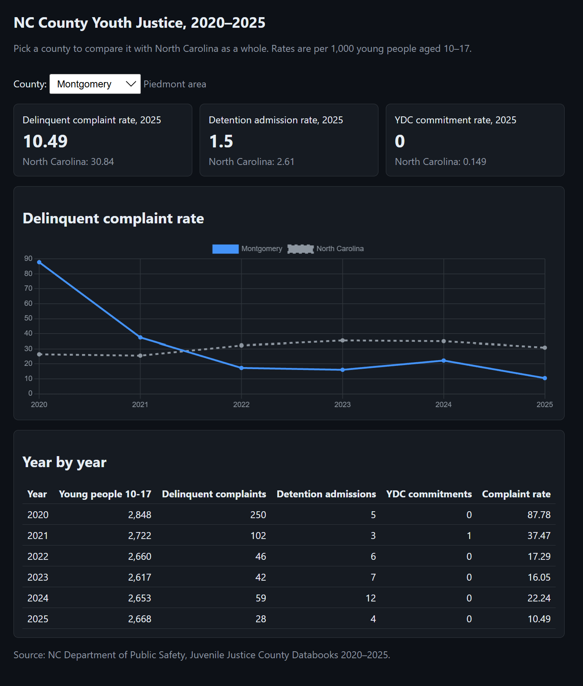

# NC County Youth Justice

A small SQL Server project that answers one question: **how does my North Carolina county compare with the state on juvenile justice?**

It uses six years (2020–2025) of county data published by the NC Department of Public Safety. The data goes into a SQL Server database, two views calculate rates, and a simple web page shows any county next to the state average.



## What's inside

```
data/county_stats.csv         the data: 100 counties x 6 years (one row per county per year)
data/original_workbooks/      the six Excel files the CSV was made from
sql/01_create_tables.sql      creates the database and two tables
sql/02_insert_data.sql        inserts the 600 rows
sql/03_create_views.sql       adds rates per 1,000 young people, plus statewide totals
sql/04_export_json.sql        turns the views into JSON for the web page
sql/05_practice_queries.sql   8 example questions to run
export_data.ps1               runs 04 and saves docs/data.js
docs/index.html               the web page
```

**Tables:** `counties` (name, area, judicial district) and `county_stats` (one row per county per year: population, complaints, detention, commitments, program numbers).
**Views:** `county_stats_with_rates` (adds three rates) and `state_totals` (statewide sums and rates per year).

## Run it

**You need:** SQL Server (the free LocalDB that comes with SSMS is fine) and SSMS.

1. Open SSMS and connect to `(localdb)\MSSQLLocalDB` with Windows Authentication. Tick **Trust server certificate**.
2. Open each file in `sql/` in order (**01**, **02**, **03**) and press **F5** to run it.
3. Try the questions in `sql/05_practice_queries.sql`: highlight one query and press F5.
4. To see the web page, just open `docs/index.html` in your browser.

**To refresh the web page after changing the data or views**, run this in PowerShell from the project folder:

```powershell
.\export_data.ps1
```

If PowerShell blocks the script, run `Set-ExecutionPolicy -Scope Process Bypass` first.

## How the CSV was made

Each DPS databook is an Excel file with a *County Data* sheet, and the columns change a bit from year to year. I kept only the columns that appear in all six years and combined them into one file with consistent column names.

## Notes on the numbers

- **Rates are calculated in SQL** as count ÷ population aged 10–17 × 1,000, using the same age group for every year so years can be compared. DPS publishes its own rates using different age groups (6–17 before 2022, 8–17 after), so these won't match theirs exactly.
- **The state rate** is total complaints ÷ total population, not an average of county rates.
- **Small counties swing a lot.** A few cases can double a rate.
- **A complaint is not a conviction.** It's a report made to a juvenile court counselor.

## Source

North Carolina Department of Public Safety, Juvenile Justice Section, *County Databook*, 2020–2025.
